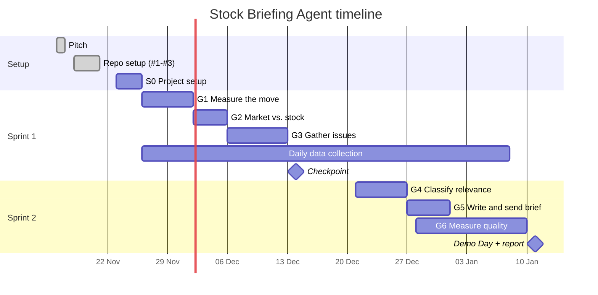

# Stock Briefing Agent

A CLI agent that watches the US stock market and tells you how it moved and what issues came with it.

> Course personal project for _Agentic Computer Science_ (University of Ljubljana FRI, 2026/27).

---

## What it is

**Problem.** 

Every morning I check how each stock on my watchlist moved and search scattered news by hand. Moves mix market, sector and stock news, so the picture is unclear.

**Solution.**

*   **Code** measures the market moves (prices, gaps, volume, trend labels).
*   **The agent** finds the related issues, classifies them and summarizes them with source links.
*   It gives market insight only. **No buy/sell advice and no cause claims.** It shows what happened in the same time window, not why.

### Features

1.  **Market Overview**: indexes, VIX, yields, sector ETFs
2.  **Move Details per Stock**: % change, gap, pre/after-hours move, volume, trend label
3.  **Why It Moved**: market-driven or stock-specific (computed by code)
4.  **Related Issues per Stock**: news, filings, rating changes, earnings, tagged direct / sector / macro
5.  **Issue Summaries with Link**: every line linked to its source, unsure items marked
6.  **Morning Delivery**: a Markdown note or a Telegram message

---

## Goals

Numbered, checkable goals. Details, "done when" checks and status: [docs/goals.md](docs/goals.md).

1. **G1 Measure the move**: % change, gap, pre/after-hours move, volume, trend label per stock
2. **G2 Separate market vs. stock**: market, sector-ETF and stock-specific parts of each move
3. **G3 Gather issues**: news, filings, rating changes, earnings in the time window, deduplicated
4. **G4 Classify relevance**: the agent tags each news item direct / sector / macro / unrelated, with a quote
5. **G5 Write and send the brief**: Markdown note + Telegram message, numbers from code only
6. **G6 Measure quality**: hand-labelled evaluation, Qwen 3.6 35B vs. a small local model

---

## Agentic stack

Every tool and pinned model tag. Roles, how I work with the agents and the change log: [docs/agentic-stack.md](docs/agentic-stack.md).

| Tool | Pinned version / tag |
| --- | --- |
| Claude Code (build) | 2.1.311 · `claude-opus-5-5`, `claude-sonnet-5-5` |
| Qwen 3.6 35B on dingo (runtime) | TBD |
| Local comparison model (Ollama) | TBD |
| yfinance, RSS, SEC EDGAR (data) | TBD |
| Telegram Bot API (delivery) | — |
| Python | TBD |

---

## Install, run, demo

Not ready yet. This section will be filled during Sprint 1.

```
# TBD
```

---

## Progress

Last updated: 21 Nov 2026 · Goals done: 0 / 6 · Red line = today



Bars marked `done` (grey) are finished, `active` is in progress. Goal status is tracked in the [goals](docs/goals.md) table.

---

## Docs

| Doc | What |
| --- | --- |
| [Goals](docs/goals.md) | Goals G1–G6 with checks and status |
| [Agentic stack](docs/agentic-stack.md) | Tools, models, how I work with the agents |
| [CLAUDE.md](CLAUDE.md) | Rules for coding agents |
| [Docs index](docs/README.md) | All docs: decisions, plans, specs, evals, session logs, repo layout |
