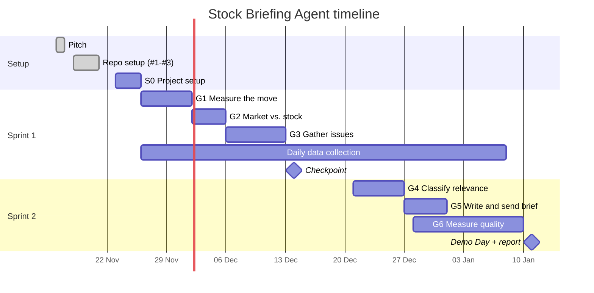

# Stock Briefing Agent

A CLI agent that watches the US stock market and tells you how it moved and what issues came with it.

> Course personal project for _Agentic Computer Science_ (University of Ljubljana FRI, 2026/27).

---

## What it is

**Problem.** 

Every morning I check how each stock on my watchlist moved and search scattered news by hand. Moves mix market, sector and stock news, so the picture is unclear.

**Solution.**

*   **Code** measures the market moves (prices, gaps, volume, trend labels).
*   **The agent** finds the related issues, classifies them and summarizes them with source links.
*   It gives market insight only. **No buy/sell advice and no cause claims.** It shows what happened in the same time window, not why.

### Features (what the user gets)

1.  **Market Overview**: indexes, VIX, yields, sector ETFs
2.  **Move Details per Stock**: % change, gap, pre/after-hours move, volume, trend label
3.  **Why It Moved**: market-driven or stock-specific (computed by code)
4.  **Related Issues per Stock**: news, filings, rating changes, earnings, tagged direct / sector / macro
5.  **Issue Summaries with Link**: every line linked to its source, unsure items marked
6.  **Morning Delivery**: a Markdown note or a Telegram message

---

## Goals and objectives

Each goal has a check that decides whether it is done.

| # | Goal | Done when | Status |
| --- | --- | --- | --- |
| G1 | **Measure the move.** % change, gap, pre/after-hours move, volume vs 20-day average, trend label (up / down / flat / pullback / rebound) per stock | Fixed test cases pass | ☐ |
| G2 | **Separate market vs. stock.** Split each move into market (SPY/QQQ), sector-ETF and stock-specific parts | Numeric tests pass | ☐ |
| G3 | **Gather issues.** Collect items from the sources below in the time window, remove duplicates, mark name/ticker matches | Collection log for every run | ☐ |
| G4 | **Classify relevance.** The agent tags each news item `direct` / `sector` / `macro` / `unrelated` with a verbatim quote and a confidence | Output passes the JSON schema check | ☐ |
| G5 | **Write and send the brief.** Markdown note + Telegram message. Numbers come from code, not from the model | Automatic checks pass before sending | ☐ |
| G6 | **Measure quality.** Hand-label ~150–200 news items and compare them with the agent: precision/recall per category, Qwen 3.6 35B vs. a small local model | Accuracy table in `docs/` | ☐ |

---

## Agentic stack

Every tool and model is declared with its version. The stack may change; every change is logged here with a date.

| Role | Tool | Pinned version / tag | What it does |
| --- | --- | --- | --- |
| Build agent | Claude Code | 2.1.311, models `claude-opus-5-5`, `claude-sonnet-5-5` | Writes and tests the code under my direction |
| Runtime agent | Qwen 3.6 35B on the course server (dingo) | TBD: exact tag | Classifies and summarizes issues (G4, G5) |
| Comparison model | Small local model via Ollama | TBD | Baseline for G6 |
| Data | yfinance, Yahoo/Nasdaq/Google News RSS, SEC EDGAR | TBD | Prices, news, ratings, earnings, filings (no API keys) |
| Delivery | Telegram Bot API | — | Sends the morning brief |
| Language | Python | TBD | — |

### How I work with the agents

*   Claude Code builds the tools. Qwen calls them at runtime.
*   One goal per fresh session. Plans and progress live in files (`docs/`), not in the chat.
*   Each goal ends with a check script that must pass before the commit.
*   Commits made with AI help carry a `Co-Authored-By` line, so the commit history is the AI-use log.

---

## Install, run, demo

Not ready yet. This section will be filled during Sprint 1.

```
# TBD
```

---

## Repository layout

```
src/    source code
docs/   architecture notes, screenshots, evaluation results
```

Data policy: raw collected data (prices, news) is **not** committed. Only the hand-labelled evaluation data is committed. Secrets (dingo key, `models.json`, Telegram token) are never committed.

---

## Progress

Last updated: 21 Nov 2026 · Goals done: 0 / 6 · Red line = today



Bars marked `done` (grey) are finished, `active` is in progress. Goal status is tracked in the [Goals](#goals-and-objectives) table.
