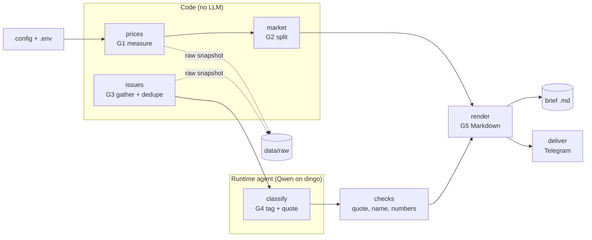

# Architecture

**Status: Draft.** Final layout is fixed in S0 (#6). Change this doc in the same PR when the code changes.

## Flow

One run of `briefing run` ([ADR 004](decisions/004-run-mode.md)): a one-shot pipeline, no server.



- Numbers flow only through code (G1 → G2 → render). The agent's output never carries numbers ([ADR 001](decisions/001-no-cause-claims.md)).
- The agent sees one stock and ≤10 pre-filtered items per call ([ADR 002](decisions/002-runtime-model-dingo-qwen.md)).
- Until G4 exists, `render` uses the unclassified issue list (interim report, #11).

## `src/` layout (planned)

```
src/briefing/
  cli.py        `briefing run` entry point
  config.py     load config file + .env
  prices.py     G1: fetch prices, metrics, trend labels
  market.py     G2: market / sector / stock-specific split
  issues.py     G3: news, RSS, SEC, ratings, earnings; time window; dedupe
  classify.py   G4: prompt, LLM call, checks, "uncertain"
  render.py     G5: Markdown brief + short Telegram text
  deliver.py    G5: send to Telegram
  store.py      raw snapshots (data/raw) and run logs
tests/
  fixtures/     small committed sample data (no network in tests)
```

Start flat: one module per stage. Split a module into a package only when it gets too big to read.

## Data between stages

Plain dataclasses, one per arrow:

| From → to | Type | Main fields |
|---|---|---|
| prices → market, render | `Move` | ticker, change_pct, gap_pct, ext_hours_pct, volume_ratio, trend_label, weak, streak_days |
| market → render | `Split` | ticker, market_pct, sector_pct, own_pct |
| issues → classify | `Issue` | ticker, source, kind (news / filing / rating / earnings), title, summary, url, published_at, name_match |
| classify → checks → render | `Tagged` | issue, category, quote, confidence, uncertain |

Field names are a starting point for the specs (`docs/specs/g1-…` etc.), not a contract yet.

## Open decisions (to discuss in S0)

- Time window for "related issues" (ADR 005)
- Config format and watchlist
- Trend-label thresholds
